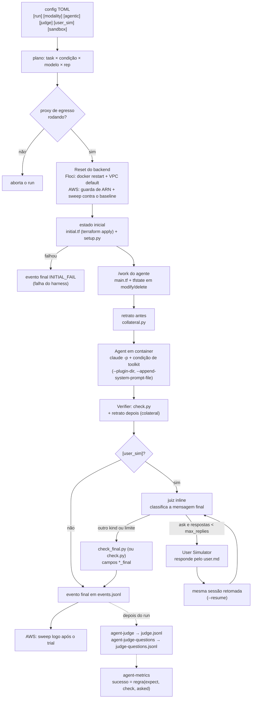

# O framework: arquitetura, método e posicionamento

## Resumo em português

O `iac-agent-eval-harness` avalia agentes de código que operam uma conta de nuvem. Um agente de
produção real (Claude Code headless, em container, com egresso só por proxy) recebe uma tarefa
num emulador AWS (Floci) ou numa conta AWS real. O harness volta o backend ao estado limpo, planta
o estado inicial, roda o agente com ou sem toolkit (skill, regras, plugin) e confere o estado
final da nuvem com um verificador determinístico. Juízes LLM validados classificam se o agente
perguntou e a qualidade da pergunta; um usuário simulado responde a pedidos ambíguos a partir de
um cartão oculto. Cada run grava a config, a procedência (commit, imagens por digest, versões de
prompt e de modelo) e um evento por trial.

O framework saiu da pesquisa da Residência (resultados no
[registro-metodologico.md](registro-metodologico.md), história em [pesquisa.md](pesquisa.md)) e
traz junto o método: cada regra do toolkit liga-se a um achado, e cada experimento novo é
registrado antes do run. O README (em inglês) é a vitrine; este diretório é o material do TCC.

Os comandos citados no registro valem para a tag `v1.0.0`, não para o `HEAD`.

## Arquitetura

Os nomes seguem o vocabulário da seção 4 do [plano-framework.md](plano-framework.md); a coluna
"nome atual" diz onde cada peça está no código (caminhos relativos a `src/iac_harness/`).

| Termo | Papel | Nome atual |
|---|---|---|
| Task | pedido, estado inicial e verificador | `modalities/tasks/<id>/` ([tarefas.md](tarefas.md)) |
| Dataset | conjunto de tasks | prefixos do id; Ambig-IaC via `[modality] dataset` |
| Backend | onde a nuvem roda (Floci ou AWS real) | `executors/`, `agentic/targets.py` |
| Agent | quem resolve a task | `agentic/agents.py` (`ClaudeCodeAgent`) |
| Modality | forma de agir (`terraform`, `cli`, `boto3`, `free`) | `modalities/spec.py` (pipeline de modalidades) |
| Toolkit | o que se dá ao agente | `agentic/conditions.py` (`REGISTRY`) |
| Verifier | confere o estado final, sem LLM | `check.py`, `check_final.py`, `collateral.py` da task |
| Judge | classificação por LLM | `agentic/judge.py`, `agentic/question_judge.py` |
| User Simulator | responde a partir do `user.md` oculto | `agentic/user_sim.py` |
| Reset | volta o backend ao estado limpo | `docker restart` do Floci; `executors/aws_sweep.py` na AWS |
| Trial | task × rep × toolkit × modelo | `runs/<id>/<task>/<rep>/<cond>/<modelo>/` |
| Run | conjunto de trials de uma config | `runs/<id>/` |
| Strata | eixos de análise | `agentic/strata.py`, `configs/strata.toml` |

### Fluxo de um trial (`agent-run`)

Pontos que o diagrama resume:

- **Isolamento.** O agente roda como usuário não-root, só em redes Docker `internal`; a única
  saída é um proxy squid cuja allowlist tem só o host do `ANTHROPIC_BASE_URL` (no alvo AWS, mais
  `.amazonaws.com`). As credenciais secretas passam ao container só pelo nome (`-e NOME`). Detalhes
  em [componentes.md](componentes.md#backends).
- **Ferramentas fixas.** Toda condição usa o mesmo conjunto (`Bash,Read,Write,Edit,Glob,Grep,Skill`,
  sem web nem subagentes); só o contexto muda. Se o plugin da condição não aparece no `system/init`
  do Claude Code, o trial termina como `CONDITION_LOAD_FAIL` (falha do harness, fora das métricas).
- **O que o agente vê.** O `prompt.md` com uma linha de ambiente (região, credenciais já
  configuradas, `/work`); em `modify`/`delete`, o `initial.tf` como `main.tf` com o tfstate; em
  consulta, o pedido de gravar a resposta em `/work/answer.json`. O `user.md`, o `check_final.py` e
  o `setup.py` nunca vão para o `/work`.
- **Sucesso.** O juiz roda depois do run. Em `expect = "act"`, sucesso é check aprovado sem ter
  perguntado; em `expect = "ask"`, é ter perguntado com o estado intocado (o `check.py` dessas
  tasks confere o estado inicial). Com usuário simulado, `success_final` é o check do estado
  depois das respostas (`agentic/outcome.py`). O colateral (`collateral_ok`) é medido à parte.

## Ciclo achado → regra → medida

O toolkit não é um conjunto de boas práticas genéricas: cada regra precisa de um achado medido.

1. **Achado.** Um run mostra um padrão (ex.: o agente chuta em remoção ambígua, ou não relê o
   estado depois de mudar). Fica no [registro-metodologico.md](registro-metodologico.md) §3, com
   run e números.
2. **Regra.** O texto do toolkit ganha uma regra que responde ao achado. A ligação regra → achado
   fica em [regras-achados.md](regras-achados.md); regra sem achado é marcada como emprestada ou
   hipótese.
3. **Medida.** A nova versão entra como condição nova (`own-rules-v2`, `own-rules-v3`), sem mudar a
   anterior, e é comparada com `none` e com a versão anterior nas mesmas tasks. A decisão de
   substituir (a v2 substituiu a v1 pelo E12) segue uma regra escrita antes do run.

O plugin distribuído (`iac-cloud`) é gerado da mesma fonte da condição medida
(`uv run python toolkit/build.py`), e `tests/test_toolkit.py` garante que o texto é o mesmo.

### Pré-registro

Antes de cada experimento, o registro ganha uma linha de decisão com pergunta, tasks, condições,
N, métrica e regra de decisão; só depois o run acontece. O que muda depois do run (emendas,
correções de desenho) é registrado com data e motivo, e o resultado é relatado mesmo quando a
hipótese não se confirma (ex.: E17). A tabela "Experimentos" do registro liga experimento →
config → run; [../configs/README.md](../configs/README.md) liga config → run.

## O que cada trial grava

Em `runs/<id>/` (fora do git):

| Arquivo | Conteúdo |
|---|---|
| `run_config.json` | a config inteira, tasks, condições, modelos, reps, workers, `prompt_version` do agente (`e3-agent-v1`), `git_commit`/`git_dirty`, versões da toolchain (terraform, opa, aws, boto3, jq e o ID da imagem), versão do Claude Code e da imagem do agente, procedência do backend (imagem e digest do Floci, ou conta/ARN/região da AWS); com `[user_sim]`, os parâmetros do simulador e do juiz inline; com Ambig-IaC, a revisão e o sha256 do dataset |
| `events.jsonl` | um evento `final` por trial: `trajectory_id`, task, condição, modelo, rep, alvo, estratos (`strata_*`), `termination`, `initial_ok`, `check_pass`/`check_details`, `collateral_ok`, `answer_present`, `final_text`, tokens, `cost_usd`, `num_turns`, contagem de ferramentas, `mutated`, `verified_state`, `verify_calls`, plugins carregados, duração; com usuário simulado, `user_turns`, `sim_exchanges` e os campos `*_final` |
| `<task>/<rep>/<cond>/<modelo>/` | `transcript.jsonl` (stream do Claude Code, segredos filtrados), `agent.stderr.txt`, o `work/` que o agente deixou; turnos retomados ganham o sufixo `.turnN` |
| `judge.jsonl` | veredito do juiz por trajetória (`kind`, `asked`) com provedor, modelo e `judge_prompt_version` |
| `judge-questions.jsonl` | notas C1–C5 da pergunta (só trajetórias com `asked = true`) |

Os valores gravados (versões de prompt, nomes de condição, nomes de campo) identificam o que foi
medido e não mudam em refatoração; os leitores (`agent-metrics`, `demo-timeline`…) continuam
lendo os runs antigos. O teste de ouro (`scripts/golden.sh check`) confere isso.

## Mapa da CLI

`uv run iac-harness <comando> --help` mostra as opções. Os 17 subcomandos, em três grupos:

**Principal: agente real**

| Comando | O que faz |
|---|---|
| `agent-run` | roda o Claude Code nas tasks × condições × modelos × reps da config |
| `agent-resume` | retoma um `agent-run`, pulando as unidades que já têm evento final |
| `agent-judge` | juiz LLM: a mensagem final pergunta algo? (`judge.jsonl`); `--sample`, `--agreement`, `--compare-with`, `--provider`, `--out` |
| `agent-judge-questions` | juiz LLM da qualidade das perguntas (`judge-questions.jsonl`) |
| `agent-questions-report` | relatório das notas das perguntas por condição; `--compare A B` dá o kappa entre juízes |
| `agent-metrics` | métricas de um run (condição × modelo, condição × `none`, estratos, usuário simulado); `--compare` dá a concordância entre dois runs (Floci × AWS real) |
| `demo-timeline` | trajetória gravada → `timeline.json` para o vídeo da demo |

**Modalidades: Terraform × AWS CLI × boto3**

| Comando | O que faz |
|---|---|
| `modality-prevalidate` | gate das tasks: estado inicial e referência de cada modalidade contra o `check.py` |
| `modality-run` | roda o agente da camada de LLM nas modalidades (`--resume` retoma) |
| `modality-metrics` | métricas de um `modality-run` (ou resumo de um replay); `--baseline` compara com a forma livre |
| `modality-replay` | reexecuta sem LLM o artefato final de cada trajetória e mede o efeito colateral |
| `modality-reask` | reclassifica sem LLM as perguntas que o parser antigo não lia (uso único, E2) |
| `ambig-prevalidate` | gate do Ambig-IaC: a referência passa no oráculo e um `main.tf` vazio reprova (E16) |

**Legado: feedback no loop (Semanas 4–6)**

| Comando | O que faz |
|---|---|
| `prevalidate` | roda a referência de cada tarefa do IaC-Eval v2 pela cadeia validate/plan/OPA/sandbox |
| `prevalidate-miac` | o mesmo para as triplas do Multi-IaC-Eval |
| `run` | roda o agente nas condições A/B/C de feedback |
| `metrics` | métricas de um `run` |

## Posicionamento

O que o harness junta: agente de produção real em container; a mesma task em três modalidades;
toolkit como variável controlada; concordância emulador × AWS real; usuário simulado para pedido
ambíguo em operação de nuvem; juízes validados; reset da AWS real por inventário; procedência em
cada run (tabela 3.1 do [plano-framework.md](plano-framework.md) e do README).

Trabalhos próximos. Links levantados em 18/11/2026 por pesquisa assistida. **Abra cada link antes
de citar no TCC.**

| Trabalho | O que faz | O que falta em relação a nós |
|---|---|---|
| aws-bench ([repo](https://github.com/aws-bench/aws-bench), [anúncio](https://aws.amazon.com/about-aws/whats-new/2026/07/aws-bench/)) | Claude Code/Kiro na AWS real, verificador de estado, rollback | sem emulador, sem modalidades, sem usuário simulado |
| IaC-Eval ([repo](https://github.com/autoiac-project/iac-eval), NeurIPS 2024) | geração de HCL, intenção em Rego | geração única, sem agente operando a nuvem |
| Ambig-IaC ([arXiv 2604.02382](https://arxiv.org/abs/2604.02382)) | tarefas ambíguas, perguntas a usuário simulado | avalia o método de perguntar, offline |
| τ-bench / τ²-bench ([arXiv 2406.12045](https://arxiv.org/abs/2406.12045), [repo](https://github.com/sierra-research/tau2-bench)) | usuário simulado com instrução oculta, pass^k | domínio de atendimento, não nuvem |
| SkillsBench ([arXiv 2602.12670](https://arxiv.org/abs/2602.12670)) | efeito de skills em agentes | genérico, não nuvem |
| Harbor / Terminal-Bench 2.0 ([repo](https://github.com/harbor-framework/harbor), [tarefas](https://docs.harborframework.com/tasks/overview)) | formato de tarefa em diretório, agentes instalados, vários sandboxes | sem nuvem, sem usuário simulado |
| UK AISI Inspect ([docs](https://inspect.aisi.org.uk/)) | Task/Solver/Scorer/Sandbox, bridge para Claude Code | genérico; o METR migrou para ele |
| AIOpsLab ([repo](https://github.com/microsoft/AIOpsLab)), ITBench ([repo](https://github.com/itbench-hub/ITBench)) | agentes de SRE/AIOps em Kubernetes | operação e incidentes, não manutenção de IaC |
| HAL ([arXiv 2510.11977](https://arxiv.org/abs/2510.11977)) | leaderboard modelo × scaffold, custo × acurácia | genérico |
| ABC checklist ([arXiv 2507.02825](https://arxiv.org/abs/2507.02825)) | checklist de validade de benchmarks de agente | referência para a seção de validade |

Emuladores: Floci ([repo](https://github.com/floci-io/floci), MIT), AWS Emulator
([repo](https://github.com/aws/aws-emulator), lançado em 11/11/2026; não avalia políticas IAM,
estado só em memória) e LocalStack (Community Edition arquivada em 03/2026, token obrigatório).

## Limitações

- **Só AWS.** Serviços e regiões do sweep são fixos (`us-east-1` + IAM + parte de EC2 em
  `us-west-2`).
- **Um agente.** Só o Claude Code (`ClaudeCodeAgent`); ferramentas e variáveis de ambiente são as
  dele. A config recusa outro `[agentic] agent`.
- **Gateway Anthropic.** O agente exige `ANTHROPIC_BASE_URL` e `ANTHROPIC_AUTH_TOKEN`; os IDs de
  modelo das configs (`Haiku 5.5`, `Sonnet 5.5`) são os do gateway.
- **Juiz padrão Anthropic** (`Sonnet 5.5`); o provedor `codex` é a alternativa.
- **Usuário simulado via Codex CLI logado** por padrão (`gpt-6-luna`); com `max_replies` limitado.
- **AWS Emulator não avaliado**; o LocalStack (token obrigatório desde 03/2026) só foi usado num spike e saiu do código (está na tag `v1.0.0`).
- **Floci 2.1.0** não reseta pela API (apaga a VPC default); o reset é por restart do container.
- **Pipelines paralelos.** Feedback no loop, modalidades e agente real têm laço, eventos e
  métricas próprios; a unificação está nas fases 3–4 do [plano-framework.md](plano-framework.md).
- **Formato de task acoplado ao catálogo:** uma task nova no catálogo exige entrada em
  `configs/strata.toml` e no conjunto esperado dos testes ([tarefas.md](tarefas.md)).
- Ameaças à validade dos resultados: registro §2 (auditoria pelo ABC) e §3.
